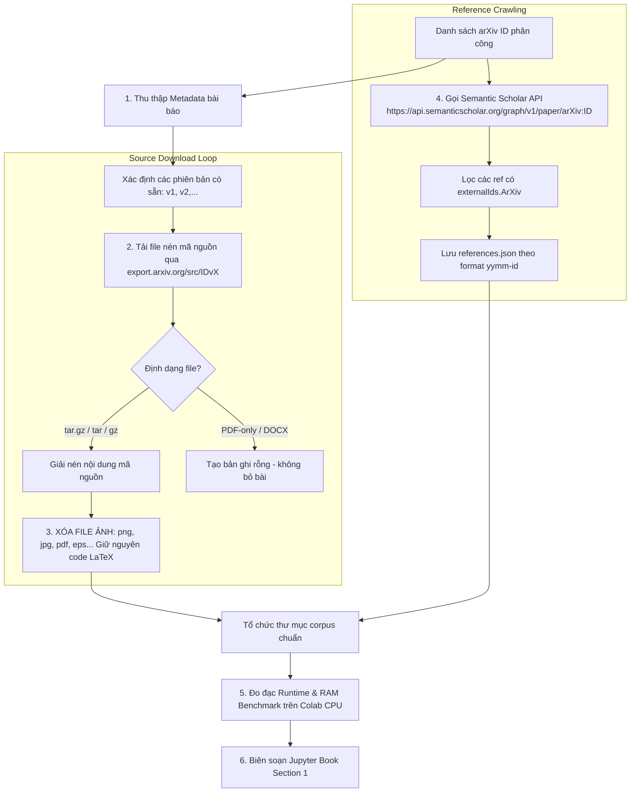

# MILESTONE 1: THU THẬP DỮ LIỆU (DATA CRAWLING)
**Tài liệu đặc tả chi tiết & Hướng dẫn kỹ thuật thực hiện**

---

## 1. MỤC TIÊU VÀ NHIỆM VỤ CỦA MILESTONE 1

Xây dựng kho ngữ liệu thô (Raw Corpus) phục vụ toàn bộ đồ án:
1. Xác định và quản lý danh sách các bài báo arXiv được phân công cá nhân (dựa trên cột H - K trên sheet đăng ký nhóm).
2. Tải toàn bộ mã nguồn toàn văn LaTeX (Full-text LaTeX Sources) cho **TẤT CẢ các phiên bản (versions: v1, v2, ...)** của từng bài báo.
3. **Lọc bỏ triệt để file hình ảnh/binary** để tối ưu dung lượng lưu trữ, chỉ giữ lại mã nguồn văn bản (`.tex`, `.bib`, v.v.).
4. Thu thập siêu dữ liệu bài báo (`metadata.json`).
5. Truy vấn danh sách trích dẫn và định danh arXiv của các bài báo trích dẫn qua **Semantic Scholar API** (`references.json`).
6. Xây dựng chương 1 của báo cáo **Jupyter Book** (phân tích thống kê dữ liệu và benchmark hiệu năng hệ thống trên Google Colab CPU).

---

## 2. QUY TRÌNH THU THẬP CHI TIẾT (STEP-BY-STEP WORKFLOW)



---

## 3. CÁC ĐIỂM KỸ THUẬT QUAN TRỌNG & LỖI CẦN TRÁNH (CRITICAL PITFALLS)

### 3.1. Điểm truy cập tải mã nguồn & Nghi thức cào dữ liệu (Rate Limiting)
- **Tải nguồn qua Mirror chuyên dụng:** Phải dùng endpoint `https://export.arxiv.org/src/{arxiv_id}` (ví dụ: `https://export.arxiv.org/src/2310.12345v1`).
- ⚠️ **CẢNH BÁO:** **TUYỆT ĐỐI KHÔNG cào dữ liệu trực tiếp từ domain `arxiv.org`**. Hành vi cào dữ liệu từ trang chính sẽ lập tức kích hoạt tường lửa chống bot và gây khóa địa chỉ IP (HTTP 403 Forbidden).
- **Quy tắc lịch sự (API Etiquette):**
  - Giãn cách tối thiểu **3 giây giữa hai request liên tiếp** (`time.sleep(3)`).
  - Chỉ chạy trên **đơn kết nối (single connection / 1 thread)** khi truy vấn arXiv.
  - Luôn đính kèm `User-Agent` mô tả rõ danh tính (ví dụ: `User-Agent: FIT-HCMUS-DataScience-Project/1.0 (contact: student@fit.hcmus.edu.vn)`).

### 3.2. Lưu ý về thư viện `arxiv.py` (Phiên bản 2025–2026)
- Thư viện `arxiv.py` từ bản 4.0.0 (tháng 5/2026) đã gỡ bỏ hoàn toàn cú pháp cũ `search.results()` và các phương thức `Result.download_pdf()`, `Result.download_source()`.
- **Cú pháp chuẩn:**
  ```python
  import arxiv
  import urllib.request
  import time

  client = arxiv.Client(
      page_size=100,
      delay_seconds=3.0,
      num_retries=3
  )
  search = arxiv.Search(id_list=["2310.12345"])
  paper = next(client.results(search))
  
  # Tự tải mã nguồn phiên bản bằng urllib/requests qua mirror export.arxiv.org
  version_id = "2310.12345v1"
  src_url = f"https://export.arxiv.org/src/{version_id}"
  # Luôn có header User-Agent và timeout
  req = urllib.request.Request(src_url, headers={'User-Agent': 'FIT-HCMUS-Project/1.0'})
  with urllib.request.urlopen(req) as resp, open(f"{version_id}.tar.gz", "wb") as f:
      f.write(resp.read())
  time.sleep(3)
  ```

### 3.3. Xử lý nhiều phiên bản (Multi-version Crawling)
- Đề bài yêu cầu: **Bắt buộc phải tải toàn bộ các version có sẵn của mỗi bài báo** (`v1`, `v2`, `v3`...).
- Nếu bài báo chỉ nộp 1 lần duy nhất trên arXiv, định danh mặc định cho thư mục phiên bản là `v1`.

### 3.4. Xóa bỏ hình ảnh (Figure Stripping)
- File mã nguồn nén của arXiv chứa rất nhiều hình ảnh chất lượng cao (PDF, PNG, JPG, EPS). Dung lượng này có thể lên đến hàng trăm MB/bài, dễ gây tràn bộ nhớ Colab hoặc ổ đĩa.
- **Yêu cầu bắt buộc:** Sau khi giải nén, lập trình duyệt qua cây thư mục và **xóa toàn bộ các tệp nhị phân hình ảnh** (`.png`, `.jpg`, `.jpeg`, `.pdf`, `.eps`, `.tiff`, `.bmp`, `.svg`).
- **Lưu ý:** Chỉ xóa tệp ảnh nhị phân. **Giữ nguyên mã lệnh LaTeX định nghĩa môi trường hình ảnh** (ví dụ: `\begin{figure}...\end{figure}`), vì Milestone 2 sẽ phân tích cấu trúc cú pháp của các khối này chứ không xử lý dữ liệu ảnh.

---

## 4. THU THẬP TRÍCH DẪN QUA SEMANTIC SCHOLAR API

### 4.1. Endpoint và Tham số
- **Endpoint:** `https://api.semanticscholar.org/graph/v1/paper/arXiv:{arxiv_id}`
- **Tham số `fields` cần lấy:** `references,references.externalIds,references.title,references.year,references.authors`
- **Ví dụ gọi API bằng Python:**
  ```python
  import requests
  import time

  def get_paper_references(arxiv_id, api_key=None):
      clean_id = arxiv_id.split('v')[0] # Bỏ suffix phiên bản nếu có
      url = f"https://api.semanticscholar.org/graph/v1/paper/arXiv:{clean_id}"
      params = {
          "fields": "references,references.externalIds,references.title,references.year,references.authors,references.venue"
      }
      headers = {}
      if api_key:
          headers["x-api-key"] = api_key
      
      resp = requests.get(url, params=params, headers=headers, timeout=15)
      if resp.status_code == 200:
          data = resp.json()
          return data.get("references", [])
      elif resp.status_code == 429:
          # Throttling handling
          time.sleep(5)
          return get_paper_references(arxiv_id, api_key)
      else:
          return []
  ```

### 4.2. Giới hạn tần suất (Rate Limit) của Semantic Scholar
- Đối với tài khoản không có API key (unauthenticated): Tối đa **1 request/giây** và không quá **100 requests trong vòng 5 phút**.
- Khi gặp mã lỗi `429 Too Many Requests`, chương trình phải có cơ chế backoff / retry. Nên đăng ký API Key miễn phí từ Semantic Scholar để ổn định tốc độ 1 req/s.

### 4.3. Xử lý định danh trích dẫn arXiv
- Chỉ các bài trích dẫn có trường `externalIds.ArXiv` mới được đưa vào file `references.json` (do arXiv ID dùng làm key của dictionary). Các trích dẫn sách, kỷ yếu không có ID arXiv sẽ bị bỏ qua ở file này.
- **Định dạng ID bài báo cũ trước năm 2007:** Có dạng `archive/YYMMNNN` (ví dụ: `hep-th/9901001`), cần giữ nguyên định danh gốc này.

---

## 5. ĐẶC TẢ CẤU TRÚC DỮ LIỆU ĐẦU RA (CORPUS CONVENTION)

Mỗi bài báo được lưu trữ trong một thư mục riêng biệt đặt tên theo định dạng chuẩn `"yymm-id"` (ví dụ: ID `2310.12345` -> tên thư mục `2310-12345`):

```text
data/
└── 2310-12345/
    ├── v1/
    │   ├── main.tex
    │   ├── intro.tex
    │   └── references.bib
    ├── v2/
    │   ├── main.tex
    │   ├── intro.tex
    │   └── references.bib
    ├── metadata.json
    └── references.json
```

### 5.1. Cấu trúc `metadata.json`
Chứa siêu dữ liệu của chính bài báo, tối thiểu các trường sau:
```json
{
  "title": "Attention Is All You Need",
  "authors": [
    "Ashish Vaswani",
    "Noam Shazeer",
    "Niki Parmar",
    "Jakob Uszkoreit"
  ],
  "submission_date": "2017-06-12T17:52:00Z",
  "revised_dates": [
    "2017-06-12T17:52:00Z",
    "2017-12-06T15:24:00Z"
  ],
  "venue": "Advances in Neural Information Processing Systems 30 (NIPS 2017)"
}
```

### 5.2. Cấu trúc `references.json`
Là một `dict` với **key** là arXiv ID (theo định dạng `"yymm-id"`, ví dụ `"1409-0473"`):
```json
{
  "1409-0473": {
    "title": "Neural Machine Translation by Jointly Learning to Align and Translate",
    "authors": [
      "Dzmitry Bahdanau",
      "Kyunghyun Cho",
      "Yoshua Bengio"
    ],
    "submission_date": "2014-09-01T00:00:00Z",
    "s2_id": "996417fa9e2a403063af3a8db8ae0be043e62f07"
  }
}
```

---

## 6. YÊU CẦU BÁO CÁO JUPYTER BOOK CHO MILESTONE 1

Phần báo cáo M1 tạo thành **Chương 1** của Jupyter Book chung của nhóm. Tất cả số liệu, biểu đồ phải được sinh động bằng code Python chạy trong quá trình build Jupyter Book.

### 6.1. Báo cáo Thống kê Dữ liệu (Data Statistics)
1. **Số lượng & Tỷ lệ thành công:**
   - Tổng số bài báo trong tập được giao.
   - Số bài thu thập thành công trọn vẹn (mã nguồn, metadata, trích dẫn).
   - Tỷ lệ thành công toàn diện (Overall Success Rate %).
   - Thống kê các trường hợp đặc biệt (ví dụ: bài chỉ có PDF, bài thiếu nguồn).
2. **Kích thước file & Hiệu quả lọc ảnh:**
   - Dung lượng trung bình một bài báo **TRƯỚC** khi xóa ảnh (bytes/MB).
   - Dung lượng trung bình một bài báo **SAU** khi xóa ảnh (bytes/MB).
   - Tỷ lệ phần trăm dung lượng tiết kiệm được nhờ thuật toán lọc ảnh.
3. **Thống kê Trích dẫn (Citation Statistics):**
   - Số lượng trích dẫn trung bình trên mỗi bài báo.
   - Tỷ lệ trích dẫn lấy thành công qua Semantic Scholar API.
   - Tỷ lệ các trích dẫn có chứa arXiv ID.

### 6.2. Phân tích Hiệu năng (Performance Benchmarking)
- **Môi trường đo đạc tiêu chuẩn:** Google Colab phiên bản CPU (CPU-only mode).
- **Chỉ số thời gian chạy (Runtime):**
  - Thời gian trung bình để xử lý 1 bài báo (giây/bài).
  - Tổng thời gian chạy quét danh sách bài (Entry discovery time).
  - Tổng thời gian chạy toàn bộ hệ thống từ đầu đến cuối (End-to-end Wall Time).
- **Chỉ số bộ nhớ (Memory Footprint):**
  - RAM tối đa tiêu thụ (Peak RAM usage - MB).
  - RAM trung bình trong quá trình cào dữ liệu (Average RAM consumption - MB).
  - Dung lượng đĩa cứng tạm tối đa cần dùng (Peak disk space).
  - Dung lượng lưu trữ thư mục kết quả cuối cùng (Final output storage size).

---

## 7. TIÊU CHÍ ĐÁNH GIÁ (GRADING RUBRIC)
- **Jupyter Book Report:** Đầy đủ các thống kê, hình ảnh & bảng số liệu sinh tự động khi compile.
- **Source Code:** Mã nguồn sạch, cấu trúc module rõ ràng, có docstring, tái lập được qua `requirements.txt`.
- **Discovery & Crawling:** Đảm bảo thu thập đúng và đủ **toàn bộ các version** của dải bài được giao.
- **Resulted Data:** Tuân thủ 100% quy ước cấu trúc thư mục, chuẩn `metadata.json` và `references.json`.
- **Scraper's Performance:** Hệ thống chạy trơn tru, có cơ chế xử lý lỗi/throttling, tối ưu RAM và dung lượng đĩa.
