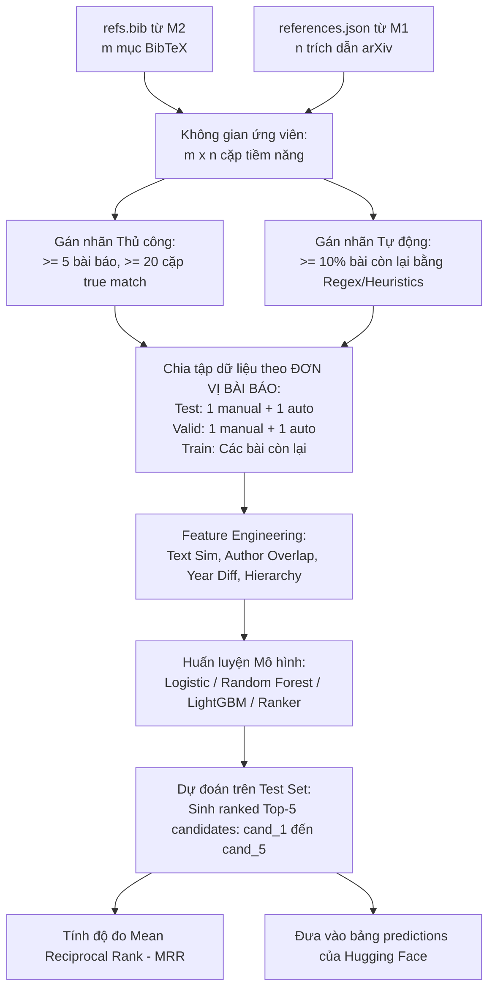

# MILESTONE 3: PIPELINE MACHINE LEARNING GHÉP NỐI TRÍCH DẪN & BÁO CÁO CUỐI KỲ
**(REFERENCE MATCHING PIPELINE, HUGGING FACE DATASET & POSTER SESSION)**
**Tài liệu đặc tả chi tiết & Hướng dẫn kỹ thuật thực hiện**

---

## 1. MỤC TIÊU VÀ NHIỆM VỤ CỦA MILESTONE 3

Milestone 3 là giai đoạn hoàn thiện toàn bộ chuỗi giá trị dữ liệu bằng Machine Learning và nghiệm thu đồ án:
1. **Bài toán Ghép nối Trích dẫn (Reference Matching / Entity Resolution):** Ghép từng mục BibTeX trích xuất được từ mã nguồn LaTeX (`refs.bib` từ M2) với đúng mã định danh arXiv ID trong danh sách trích dẫn ngoại vi (`references.json` từ M1 do Semantic Scholar cung cấp).
2. **Xây dựng Ground Truth:** Gán nhãn thủ công (Manual Labeling) $\ge 5$ bài báo ($\ge 20$ cặp trích dẫn) và gán nhãn tự động theo heuristic (Automatic Labeling) cho $\ge 10\%$ số bài báo còn lại.
3. **Trích xuất Đặc trưng (Feature Engineering):** Thiết kế, phân tích và chứng minh tính hiệu quả của các đặc trưng so khớp văn bản, tác giả, năm xuất bản và phân cấp tài liệu.
4. **Mô hình hóa (Data Modeling) & Đánh giá (Evaluation):** Chia tập dữ liệu chuẩn theo đơn vị bài báo (Train/Val/Test Split), huấn luyện mô hình xếp hạng Top-5 ứng viên và đánh giá bằng độ đo **Mean Reciprocal Rank (MRR)**.
5. **Xuất bản Hugging Face Dataset (Final Data Submission):** Xuất bản toàn bộ kho dữ liệu đã xử lý thành 7 bảng Parquet có schema phẳng chuẩn chỉnh lên tài khoản Hugging Face. **Lưu ý: Mỗi sinh viên tự upload phần dữ liệu cá nhân lên Hugging Face cá nhân để nộp link.**
6. **Báo cáo Poster:** Thiết kế poster 1 trang đơn định dạng **khổ A2 dọc (Portrait A2)** lưu dưới dạng file PPTX đặt tên `<ID nhóm>.pptx`, sau đó in ấn và thuyết trình tại buổi Poster Session.

---

## 2. PIPELINE MACHINE LEARNING GHÉP NỐI TRÍCH DẪN



---

## 3. CHI TIẾT CÁC BƯỚC THỰC HIỆN PIPELINE

### 3.1. Làm sạch Dữ liệu (Data Cleaning)
Chuẩn hóa văn bản trường trích dẫn trước khi so khớp:
- Chuyển toàn bộ về chữ thường (lowercasing).
- Loại bỏ stop-words học thuật và ký tự đặc biệt, dấu câu LaTeX (`\"{o}`, `\'e`, `~`).
- Chuẩn hóa tên tác giả: Tách họ (Last Name) và tên đệm/tên (First Name/Initials) để so khớp bền vững trước các dị bản cách viết tên.

### 3.2. Gán nhãn Dữ liệu (Data Labelling & Ground Truth Creation)
Không gian bài toán: Trong một bài báo có $m$ mục BibTeX và $n$ trích dẫn trong `references.json`, có tổng cộng $m \times n$ cặp ghép tiềm năng. Nhãn là nhị phân ($1$ nếu cặp đó chỉ cùng một bài báo thực tế, $0$ nếu không khớp).
- **Quy định gán nhãn:**
  1. **Manual Labelling (Thủ công):** Bắt buộc gán nhãn thủ công cho **ít nhất 5 bài báo**, tổng số cặp được xác định chuẩn xác (ground-truth pairs) phải đạt **tối thiểu 20 cặp**.
  2. **Automatic Labelling (Tự động):** Áp dụng giải thuật heuristic/regex/chuẩn hóa chuỗi cổ điển (Exact Title Match sau khi chuẩn hóa, Fuzzy Wuzzy score > 95%, trùng tác giả 1 và năm) để gán nhãn tự động cho **ít nhất 10%** số lượng bài báo còn lại.
- Lưu ý: Cần tài liệu hóa định dạng và quy tắc gán nhãn rõ ràng trong repository và poster.

### 3.3. Trích xuất Đặc trưng (Feature Engineering)
Nhóm cần xây dựng đa dạng các nhóm đặc trưng cho từng cặp $(BibTeX_i, Ref_j)$:
1. **Nhóm đặc trưng tương đồng tiêu đề (Title Similarity):**
   - Khoảng cách Levenshtein / Damerau-Levenshtein normalized.
   - Jaro-Winkler similarity.
   - Jaccard similarity trên tập từ (Token-level Jaccard).
   - Độ đo Cosine trên không gian vector TF-IDF hoặc Character n-grams (3-gram, 4-gram).
2. **Nhóm đặc trưng tác giả (Author Overlap):**
   - Tỷ lệ trùng khớp họ của tác giả đầu tiên (First Author Last Name Match - binary).
   - Jaccard similarity giữa danh sách họ của tất cả tác giả.
   - Tỷ lệ số tác giả trùng lặp trên tổng số tác giả.
3. **Nhóm đặc trưng thời gian (Temporal Features):**
   - Khoảng cách tuyệt đối giữa năm xuất bản BibTeX và năm của arXiv Ref: $|Year_{bib} - Year_{ref}|$.
   - Biến nhị phân chỉ thị trùng năm tuyệt đối ($Year_{bib} == Year_{ref}$).
4. **Nhóm đặc trưng phân cấp tài liệu (Document Hierarchy Features):**
   - Vị trí xuất hiện của citation trong cây phân cấp M2 (ví dụ: xuất hiện ở Section Introduction, Related Work hay Methodology).
   - Tần suất trích dẫn (tổng số lần citation key được gọi trong văn bản).
5. **Yêu cầu quan trọng:** Mọi đặc trưng được đưa vào mô hình phải có **biện giải (justification)** và **phân tích dữ liệu trực quan (data analysis)** thể hiện rõ lý do tại sao đặc trưng đó giúp phân biệt cặp đúng/sai.

### 3.4. Chiến lược Chia tập Dữ liệu (Publication-level Data Split)
⚠️ **Lưu ý đặc biệt:** Để tránh rò rỉ dữ liệu (data leakage), việc chia tập phải thực hiện theo **đơn vị bài báo (by publication)** chứ không xáo trộn ngẫu nhiên từng cặp trích dẫn:
- **Test Set:** Gồm đúng **1 bài báo từ tập gán nhãn thủ công** + **1 bài báo từ tập gán nhãn tự động**.
- **Validation Set:** Gồm đúng **1 bài báo từ tập gán nhãn thủ công** + **1 bài báo từ tập gán nhãn tự động**.
- **Training Set:** Toàn bộ các bài báo còn lại (các bài thủ công còn lại + các bài tự động còn lại).

### 3.5. Huấn luyện Mô hình & Đánh giá (Modeling & Evaluation)
- **Mô hình đề xuất:** Binary Classification (Logistic Regression, Random Forest, XGBoost, LightGBM) hoặc Learning-to-Rank (LambdaMART). Với mỗi mục BibTeX, mô hình tính điểm số khớp với toàn bộ $n$ trích dẫn ứng viên, sau đó sắp xếp giảm dần và lấy ra **Top-5 ứng viên cao nhất** (`cand_1` đến `cand_5`).
- **Độ đo đánh giá: Mean Reciprocal Rank (MRR)**
  $$\text{MRR} = \frac{1}{|Q|} \sum_{i=1}^{|Q|} \frac{1}{\text{rank}_i}$$
  - Trong đó: $|Q|$ là tổng số trích dẫn cần ghép nối trong tập Test.
  - $\text{rank}_i \in \{1, 2, 3, 4, 5\}$ là vị trí xếp hạng của đáp án đúng trong Top-5 dự đoán của mô hình.
  - Nếu đáp án đúng không xuất hiện trong Top-5, điểm số reciprocal rank của trích dẫn đó bằng $0$.
- *Ghi chú từ đề bài:* Sinh viên sử dụng các phương pháp tri thức ngoại vi (như mô hình ngôn ngữ lớn LLM hoặc pretrained language models) sẽ được đánh giá và chấm điểm trong một nhóm riêng biệt với các phương pháp học máy truyền thống.

---

## 4. XUẤT BẢN DATASET TRÊN HUGGING FACE (7 TABLES SCHEMA)

Đồ án **không có nộp dữ liệu trung gian**, toàn bộ dữ liệu của 3 Milestone sẽ được xuất bản dưới dạng **Hugging Face Dataset** bao gồm 7 bảng định dạng **Sharded Parquet** với cấu trúc schema phẳng, chuẩn xác:

### 4.1. Quy định nộp bài của Moodle FIT-HCMUS
> *"Dữ liệu nộp trên Hugging Face sau cùng ở dạng dataset như hướng dẫn trong đề bài, mỗi thành viên trong nhóm tự upload phần dữ liệu của mình và tạo thành dataset riêng dưới tài khoản Hugging Face cá nhân. Sinh viên dán link chia sẻ công khai của dataset đã tạo vào textbox dưới đây để nộp bài, do đó mỗi sinh viên đều phải nộp phần này."*

### 4.2. Danh mục 7 Bảng Parquet & Chi tiết Schema

| Bảng | Tên cột & Kiểu dữ liệu | Mô tả nguồn gốc dữ liệu |
|:---|:---|:---|
| **1. `papers`** | - `arxiv_id` (string, non-null)<br>- `title` (string)<br>- `authors` (list of strings)<br>- `submission_date` (ISO string)<br>- `revised_dates` (list of strings)<br>- `venue` (string, nullable) | Xây dựng từ metadata bài báo đã thu thập ở M1 |
| **2. `elements`** | - `element_id` (string, non-null)<br>- `arxiv_id` (string, non-null)<br>- `kind` (string, dictionary)<br>- `content` (string) | Các phần tử trong cây phân cấp đã được khử trùng lặp toàn văn xuyên phiên bản ở M2 |
| **3. `element_parents`** | - `arxiv_id` (string)<br>- `version` (int)<br>- `element_id` (string, non-null)<br>- `parent_id` (string, non-null) | Bản đồ quan hệ cha - con của các phần tử phân cấp theo từng phiên bản ở M2 |
| **4. `bibtex_entries`** | - `arxiv_id` (string)<br>- `citation_key` (string, non-null)<br>- `entry_type` (string, dictionary)<br>- `title` (string)<br>- `authors` (list of strings)<br>- `year` (int, nullable)<br>- `doi` (string)<br>- `journal` (string)<br>- `url` (string) | Toàn bộ các mục BibTeX sau khi đã hợp nhất và chuẩn hóa ở M2 |
| **5. `paper_references`** | - `arxiv_id` (string)<br>- `ref_arxiv_id` (string, non-null)<br>- `ref_title` (string)<br>- `ref_authors` (list of strings)<br>- `ref_submission_date` (string)<br>- `ref_s2_id` (string) | Siêu dữ liệu trích dẫn lấy từ Semantic Scholar API ở M1 |
| **6. `predictions`** | - `arxiv_id` (string, non-null)<br>- `partition` (string, dictionary: `train`, `valid`, hoặc `test`)<br>- `citation_key` (string, non-null)<br>- `groundtruth_arxiv_id` (string, nullable)<br>- `cand_1` đến `cand_5` (string, nullable) | Kết quả ghép nối của mô hình M3. *Chỉ chứa các bài báo nằm trong tập Train, Valid, Test của M3.* |
| **7. `sources`** | - `arxiv_id` (string)<br>- `version` (int)<br>- `filename` (string)<br>- `content` (string) | Toàn văn mã nguồn văn bản LaTeX/BibTeX của từng phiên bản |

### 4.3. Cấu trúc Thư mục Kho Hugging Face & Dataset Card
```text
<your-hf-dataset-repo>/
├── README.md
└── data/
    ├── papers/
    │   └── *.parquet
    ├── elements/
    │   └── *.parquet
    ├── element_parents/
    │   └── *.parquet
    ├── bibtex_entries/
    │   └── *.parquet
    ├── paper_references/
    │   └── *.parquet
    ├── predictions/
    │   └── *.parquet
    └── sources/
        └── *.parquet
```

Nội dung YAML Dataset Card tại đầu file `README.md` của repo Hugging Face:
```yaml
---
configs:
- config_name: papers
  data_files:
  - split: train
    path: data/papers/*.parquet
- config_name: elements
  data_files:
  - split: train
    path: data/elements/*.parquet
- config_name: element_parents
  data_files:
  - split: train
    path: data/element_parents/*.parquet
- config_name: bibtex_entries
  data_files:
  - split: train
    path: data/bibtex_entries/*.parquet
- config_name: paper_references
  data_files:
  - split: train
    path: data/paper_references/*.parquet
- config_name: predictions
  data_files:
  - split: train
    path: data/predictions/*.parquet
- config_name: sources
  data_files:
  - split: train
    path: data/sources/*.parquet
---
```

---

## 5. ĐẶC TẢ BÁO CÁO POSTER VÀ POSTER SESSION

### 5.1. Quy cách Nộp Poster trên Moodle
- **Đại diện mỗi nhóm nộp** 1 file duy nhất lên Moodle.
- **Định dạng file:** PowerPoint (`.pptx`), gồm đúng **1 trang duy nhất (single-page)**.
- **Kích thước / Khổ giấy:** **Khổ A2 Dọc (Portrait A2)**: Chiều rộng 42.0 cm $\times$ Chiều cao 59.4 cm.
- **Quy chuẩn đặt tên file:** `<ID nhóm>.pptx` (Ví dụ: `Nhom05.pptx` theo ID đăng ký).

### 5.2. Nội dung Cần Trình Bày trên Poster
Poster chỉ có 1 trang nên nhóm cần chọn lọc những kết quả xuất sắc nhất, có chiều sâu nhất để tạo sự khác biệt:
1. **Kiến trúc Pipeline:** Sơ đồ tổng thể từ Crawling $\rightarrow$ Parsing $\rightarrow$ Feature Engineering $\rightarrow$ Model Matching.
2. **Kỹ thuật Phân tích cú pháp & Khử trùng lặp (M2):** Điểm nổi bật trong việc dựng cây phân cấp và hiệu quả giảm dư thừa dữ liệu.
3. **Kỹ thuật trích đặc trưng (Feature Engineering Highlights):** Trình bày các đặc trưng độc đáo nhất, kèm biểu đồ trực quan hóa dữ liệu và lập luận toán học/ngữ nghĩa.
4. **Mô hình Học máy & Kết quả Đánh giá:** Bảng so sánh các mô hình theo độ đo MRR trên tập Test, phân tích Error Analysis (những ca ghép nối sai và nguyên nhân).
5. **Thuyết trình tại Poster Session:** Sau khi nộp duyệt, nhóm in màu bản poster A2 và thuyết trình trước Ban Giảng Huấn.

---

## 6. TIÊU CHÍ ĐÁNH GIÁ (GRADING RUBRIC)
- **ML Pipeline Implementation:** Thực hiện bài bản các khâu Clean, Label, Feature, Model, Evaluation; không bị rò rỉ dữ liệu giữa các tập.
- **Evaluation & Analysis:** Tính toán MRR chính xác, biện giải đặc trưng xuất sắc, phân tích sâu sắc kết quả.
- **Dataset Schema:** Bộ dữ liệu Parquet trên Hugging Face tuân thủ 100% định dạng, kiểu dữ liệu và cấu hình card.
- **Code Quality & Reproducibility:** Code sạch, có hướng dẫn chạy rõ ràng trong repo GitHub chung.
- **Poster & Session:** Thiết kế poster chuẩn A2 dọc, tính thẩm mỹ cao, thuyết trình lưu loát tại hội trường.
