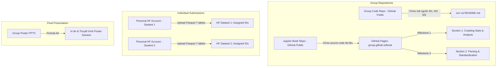

# TỔNG QUAN ĐỒ ÁN MÔN HỌC: NHẬP MÔN KHOA HỌC DỮ LIỆU (INTRO TO DATA SCIENCE)
**Chủ đề:** arXiv Project — Thu thập, Tiền xử lý phân cấp dữ liệu LaTeX & Xây dựng Pipeline Machine Learning Ghép nối Trích dẫn (Reference Matching)
**Khoa/Trường:** Khoa Công nghệ Thông tin - Trường ĐH Khoa học Tự nhiên, ĐHQG-HCM (FIT - HCMUS)

---

## 1. MỤC TIÊU DỰ ÁN VÀ BỨC TRANH TOÀN CẢNH (BIG PICTURE)

Đồ án mô phỏng toàn bộ quy trình thực tế của một Kỹ sư / Nhà khoa học Dữ liệu (Data Scientist / Data Engineer) xử lý dữ liệu phi cấu trúc quy mô lớn:
1. **Thu thập dữ liệu thô (Data Crawling - M1):** Thu thập toàn văn mã nguồn LaTeX (`.tex`, `.bib`) của tất cả các phiên bản của các bài báo arXiv được phân công, cùng metadata bài báo và metadata danh sách trích dẫn ngoại vi từ Semantic Scholar API.
2. **Tiền xử lý & Phân cấp dữ liệu (Hierarchical Parsing & Standardization - M2):** Phân tích mã nguồn LaTeX đa file, bóc tách cấu trúc cây tài liệu (Document Tree Hierarchy), chuẩn hóa cú pháp toán học, lọc nhiễu, chuyển đổi `\bibitem` thành BibTeX, và khử trùng lặp (Deduplication) 2 cấp độ (toàn văn & trích dẫn).
3. **Pipeline Học máy Ghép nối Trích dẫn (Reference Matching Pipeline - M3):** Mô hình hóa bài toán ghép nối (Entity Resolution / Reference Matching) giữa các trích dẫn BibTeX trích xuất được từ bài báo với kho ID arXiv từ Semantic Scholar. Xây dựng bộ dữ liệu gán nhãn, trích đặc trưng, huấn luyện mô hình xếp hạng/phân loại, đánh giá theo độ đo Mean Reciprocal Rank (MRR).
4. **Phát hành Dữ liệu & Báo cáo:** Xuất bản dataset hoàn chỉnh gồm 7 bảng Parquet lên Hugging Face, xuất bản báo cáo tương tác bằng Jupyter Book trên GitHub Pages, và bảo vệ kết quả bằng Poster (khổ A2 dọc) tại Poster Session.

---

## 2. CÁC HẠN MỤC NỘP BÀI VÀ QUY ĐỊNH (DEADLINES & SUBMISSION CHANNELS)

Theo thông báo từ hệ thống Moodle FIT-HCMUS:

| Hạng mục bài tập Moodle | Link Moodle | Đối tượng nộp | Định dạng & Yêu cầu cụ thể |
|:---|:---|:---|:---|
| **Đồ án: Jupyter Book** | [Assign ID 129042](https://courses.fit.hcmus.edu.vn/mod/assign/view.php?id=129042) | **Đại diện mỗi nhóm** | - Nộp link **GitHub Pages (`github.io`)** đến Jupyter Book tương ứng với **Milestone 1 và Milestone 2**.<br>- **Lưu ý quan trọng:** Cho phép cập nhật/chỉnh sửa nội dung sau hạn nộp phần này và trước hạn nộp Poster, miễn là đường link Jupyter Book không đổi (đây là bài nộp đốc thúc tiến độ). |
| **Đồ án: Hugging Face Dataset** | [Assign ID 129043](https://courses.fit.hcmus.edu.vn/mod/assign/view.php?id=129043) | **TỪNG THÀNH VIÊN** *(Bắt buộc mỗi cá nhân tự nộp)* | - **Mỗi thành viên tự upload phần dữ liệu được phân công của mình** và tạo thành dataset riêng dưới tài khoản Hugging Face cá nhân.<br>- Định dạng chuẩn: Sharded Parquet (7 bảng) đúng schema M3.<br>- Dán link chia sẻ công khai (public URL) của dataset cá nhân vào textbox. |
| **Đồ án: Poster báo cáo** | [Assign ID 129044](https://courses.fit.hcmus.edu.vn/mod/assign/view.php?id=129044) | **Đại diện mỗi nhóm** | - Nộp 1 file PPTX chứa poster 1 trang đơn.<br>- Định dạng: **Khổ A2 dọc (Portrait A2)**.<br>- Đặt tên file đúng chuẩn: `<ID nhóm>.pptx` (ví dụ: `Nhom01.pptx` theo ID đăng ký).<br>- Sau khi duyệt, nhóm in poster ra giấy và thuyết trình tại buổi Poster Session cuối kỳ. |
| **Kho ID phân công** | Sheet đăng ký nhóm (cột H - K) | **Từng cá nhân** | - Khoảng ID bài báo arXiv được phân công riêng cho từng cá nhân (cột H - K trên sheet đăng ký).<br>- Giúp độc lập tiến độ và tránh rủi ro phát sinh khi nhóm thay đổi thành viên. |

---

## 3. CẤU TRÚC KHO LƯU TRỮ VÀ TÀI NGUYÊN (REPOSITORIES ARCHITECTURE)

Dự án yêu cầu quản lý phân tách rõ ràng giữa mã nguồn và báo cáo:



### 3.1. Repository Mã nguồn (Shared Group Repository)
- **Tính chất:** Duy nhất 1 repository GitHub public cho cả nhóm suốt toàn bộ đồ án.
- **Lịch sử commit:** Mang tính chất tích lũy (cumulative history), ghi nhận đầy đủ tiến trình đóng góp của từng thành viên.
- **Nội dung:** Chỉ chứa source code (`.py`, `.ipynb`), `requirements.txt`, và `README.md`. **TUYỆT ĐỐI KHÔNG commit file dữ liệu thô, file nén tar.gz, hoặc file binary nặng lên Git repo.**
- **Cấu trúc thư mục chuẩn:**
  ```text
  <group-repo>/
  |-- src/
  |   |-- *.py / *.ipynb
  |   |-- requirements.txt
  |-- README.md
  ```

### 3.2. Repository Báo cáo (Jupyter Book Repository)
- Tách biệt hoàn toàn với repo code.
- Kích hoạt GitHub Pages để xuất bản website dạng sách (`https://<username>.github.io/<repo>/`).
- M1 tạo chương 1; M2 bổ sung chương 2 vào cùng cuốn sách này.
- **Quy tắc vàng:** Tất cả bảng số liệu, biểu đồ phải được **sinh trực tiếp trong quá trình build (compile) Jupyter Book**, không được chụp ảnh màn hình dán vào.

---

## 4. TỔNG HỢP 3 MILESTONE

```mermaid
flowchart LR
    subgraph M1: Crawling
        ID[Danh sách arXiv ID] --> Downloader[Tải mã nguồn LaTeX .tar.gz\nexport.arxiv.org/src/]
        ID --> S2[Semantic Scholar API\nreferences]
        Downloader --> CleanFig[Lọc bỏ ảnh/figure binary]
        CleanFig --> CorpusM1[Thư mục bài báo:\nv1, v2, metadata.json, references.json]
    end

    subgraph M2: Parsing & Standardization
        CorpusM1 --> MultiTex[Xác định main .tex & include tree]
        MultiTex --> Tree[Dựng Document Hierarchy Tree]
        Tree --> CleanNorm[Lọc format rác & Chuẩn hóa toán]
        CleanNorm --> BibExtract[Bóc tách bibitem -> BibTeX]
        BibExtract --> Dedup[Khử trùng lặp 2 cấp:\nText elements & BibTeX cite]
        Dedup --> OutputM2[hierarchy.json & refs.bib]
    end

    subgraph M3: Matching ML Pipeline
        OutputM2 & CorpusM1 --> GroundTruth[Gán nhãn Manual >=5 pubs\n+ Heuristic Auto >=10%]
        GroundTruth --> FeatureEng[Feature Engineering: mxn cặp]
        FeatureEng --> TrainModel[Train/Val/Test Split theo Pub\nHuấn luyện mô hình xếp hạng]
        TrainModel --> EvalMRR[Đánh giá Top-5 bằng MRR]
        EvalMRR --> HF[7 Bảng Parquet sharded lên Hugging Face]
    end
```



### Chi tiết các tài liệu đính kèm:
1. [MILESTONE_1_CRAWLING.md](file:///d:/000MINHTHONG/Final-year%20Semeter%20I/IDS/Prj/docs/MILESTONE_1_CRAWLING.md) — Hướng dẫn kỹ thuật và yêu cầu thu thập dữ liệu.
2. [MILESTONE_2_PARSING.md](file:///d:/000MINHTHONG/Final-year%20Semeter%20I/IDS/Prj/docs/MILESTONE_2_PARSING.md) — Hướng dẫn phân tích cú pháp phân cấp và chuẩn hóa dữ liệu.
3. [MILESTONE_3_MATCHING_AND_SUBMISSION.md](file:///d:/000MINHTHONG/Final-year%20Semeter%20I/IDS/Prj/docs/MILESTONE_3_MATCHING_AND_SUBMISSION.md) — Pipeline ML, Hugging Face Dataset (7 tables) và Poster A2.
4. [CHECKLIST_AND_DELIVERABLES.md](file:///d:/000MINHTHONG/Final-year%20Semeter%20I/IDS/Prj/docs/CHECKLIST_AND_DELIVERABLES.md) — Bảng kiểm soát tiến độ, rubric chấm điểm và checklist kiểm tra trước khi nộp.
